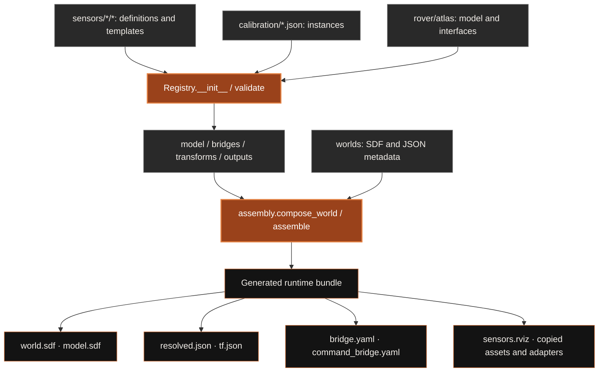
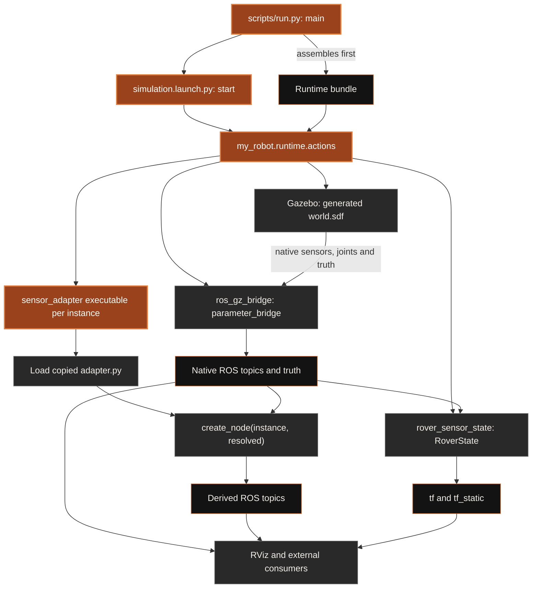

# ROAM / ATLAS — architecture and sensor fidelity

**Target:** Gazebo Harmonic · ROS 2 Jazzy · Python assembly · provisional hardware calibration.

The repository assembles reusable components into one runtime bundle. Calibration
owns sensor instances; sensor folders own reusable behavior. No manufacturer SDK
generates these measurements. Configured rates below are simulation-time targets,
not evidence of achieved runtime performance or hardware equivalence.

## Code ownership

| Source | Responsibility |
| --- | --- |
| [`rover/atlas/`](../rover/atlas/) | Physical `model.sdf`, meshes, wheel joints, DiffDrive, ground-truth OdometryPublisher and keyboard controller. `definition.json` exports base/truth/command interfaces and control bindings. |
| [`sensors/`](../sensors/) | Per-implementation `definition.json`, native `sensor.sdf` or optional `plugin.sdf`, optional `adapter.py` and `validate.py`. No instance mounts belong here. |
| [`calibration/`](../calibration/) | Instance IDs, implementation selection, enabled flags, topics, frames, extrinsics and supported setting overrides. JSON by default; YAML via PyYAML. |
| [`worlds/`](../worlds/) | Environment SDF and adjacent JSON spawn/geographic/magnetic metadata. No checked-in rover or sensor instances. |
| [`scripts/assemble.py`](../scripts/assemble.py) | `arguments()` and `main()`: select inputs and generate a bundle without ROS. |
| [`registry.py`](../src/my_robot/my_robot/registry.py) | `Registry`: resolve, validate, build sensor instances, model, bridges, transforms and output contracts. |
| [`assembly.py`](../src/my_robot/my_robot/assembly.py) | `compose_world()` and `assemble()`: combine inputs and materialize the bundle. |
| [`runtime.py`](../src/my_robot/my_robot/runtime.py) | `actions()`: construct ROS launch processes from the resolved bundle. |
| [`sensor_adapter.py`](../src/my_robot/my_robot/sensor_adapter.py) | `main()`: dynamically load each copied adapter and call its factory. |
| [`rover_state.py`](../src/my_robot/my_robot/rover_state.py) | `RoverState`: publish static sensor TF and truth-driven dynamic base TF. |
| [`visualization.py`](../src/my_robot/my_robot/visualization.py) | `write_rviz()`: generate displays for the selected sensors. |
| [`asset_install.py`](../src/my_robot/my_robot/asset_install.py) | `asset_data_files()`: install rover, sensors, calibration and worlds preserving directory layout. |
| [`scripts/validate.py`](../scripts/validate.py), [`validate_sensors.py`](../scripts/validate_sensors.py) | Structural inspection and optional live output checks. |

## Assembly-time flow

Editable Mermaid source uses charcoal for code, burnt orange for orchestration,
and near-black for generated artifacts. World configuration enters
`compose_world()` directly; it is not parsed by `Registry`.

### Resolution and validation

`Registry.__init__()` reads the rover definition and resolves control bindings
from its SDF. Each calibration instance selects a component directory through
`component_path()`. Its settings override the component's defaults. `--enable`
and `--disable` apply to instance IDs before validation. ATLAS is the default;
the historical selections are ordinary calibration files, not alternate code paths.

`validate()` checks IDs, enabled booleans, duplicate frames/joints, finite poses,
positive rates, nonnegative noise standard deviations, supported setting names,
connected acyclic sensor transforms, sensor/transport topic agreement and bridge
topic uniqueness. Active components may declare `validator`; its
`validate(instance, registry)` checks component-specific dependencies. Encoder
validation checks wheel joints; GNSS velocity checks its enabled source and
supported antenna mounting assumptions. Truth-derived components require a
rover truth interface.

This is not a complete SDFormat schema or physical-calibration validator. It
does not prove that every numeric sensor parameter is physically plausible or
that installed Gazebo/bridge binaries honor all configured fields.

### Construction and mounting

`Registry.model()` reads a fresh base SDF. For a `kind: gazebo` component it
copies `sensor.sdf`, assigns names, applies settings with `set_text()`, inserts
mount and measurement poses, and adds a fixed joint. For active derived
components, an optional `plugin.sdf` receives `plugin_bindings` and `plugin_lists`.

`set_text()` requires an existing XML element. The definition's `settings` keys
are the allowlist: arbitrary calibration keys cannot create new SDF behavior.
Disabled native sensors retain their housing mass/collision and static TF, but
lose their `<sensor>` element and measurement bridges. Disabling is therefore
not equivalent to physically removing the sensor housing.

`compose_world()` appends the assembled rover at the selected spawn pose. It
adds required systems once: Physics, UserCommands, SceneBroadcaster and the
sensor-requested Sensors/Imu/NavSat/Magnetometer systems. GPU sensors use Ogre 2.
Geographic and magnetic metadata are added only if absent in the world SDF.
World terrain remains unchanged. `empty` intentionally has no supporting floor.

### Frames, calibration and bundle contents

`Registry.instance_transforms()` builds parent → housing link → measurement
frame → optional camera optical frame. Poses are `x y z roll pitch yaw`, metres
and radians. Camera optical rotation is roll −π/2, yaw −π/2, giving right/down/
forward axes from a forward/left/up body convention. `mount_pose` and
`sensor_pose` are distinct: the LiDAR housing is at z=0.28 m and its measurement
origin is another 0.03 m above it. Front cameras have a provisional 0.24 m baseline.

Bridge `frame_id` overrides label measurements; they do not rotate vectors or
point clouds. Sensor orientation, frame convention and TF must agree. ATLAS
calibration is explicitly provisional, including intrinsics and LiDAR–IMU alignment.

| Artifact | Meaning |
| --- | --- |
| `world.sdf` | Selected world with assembled rover and required systems; Gazebo loads this file. |
| `model.sdf` | The same assembled rover for inspection. |
| `resolved.json` | Resolved instances, rover interfaces, transforms, bridges, expected outputs and adapter records. Runtime reads this instead of recalculating calibration. |
| `bridge.yaml` | Full bridge mappings, serialized as JSON (valid YAML). |
| `command_bridge.yaml` | Only ROS_TO_GZ mappings for control without ROS sensor streaming. |
| `tf.json` | Reviewable transform list matching `resolved.json`; the TF node consumes the resolved list. |
| `sensors.rviz` | Generated visualization configuration. |
| `assets/`, `adapters/` | Copied rover/component resources and active adapter component directories. |

`assemble()` refuses nonempty output directories. Relative component mesh paths
are checked and rewritten to absolute `file:` URIs into copied assets. External
`model://` resources, if introduced, remain external dependencies. Bundles with
absolute mesh paths must be regenerated after relocation. Nothing writes back
to reusable models or calibration during assembly.

## Runtime flow

The native arrow from Gazebo to the bridge is **Gazebo Transport**, not DDS.
The bridge converts supported message types; adapters consume and publish ROS 2
messages. Sensor systems own generation: rendered geometry feeds cameras/GPU
LiDAR, simulated motion feeds IMUs/joints, and world coordinates feed NavSat.
RViz and external autonomy nodes consume data; no perception or localization
estimator is implemented here.

`run.py:main()` keeps a temporary bundle alive for the launch lifetime, or uses
`--output`. `simulation.launch.py:start()` passes launch arguments to `actions()`.
`gazebo:=false` supports attaching ROS to an existing matching bundle. Full ROS
mode starts one bridge, the TF node and active adapters. Control-only mode uses
`command_bridge.yaml`. Optional RViz and rover-owned keyboard control are launched
separately. Gazebo exit and required bridge/TF/adapter exit trigger shutdown;
RViz and keyboard exit are not marked critical. The runner waits for launch
shutdown before releasing temporary files.

Managed nodes use simulation time; `/clock` is bridged. `RoverState.on_truth()`
publishes `world → base_link` from ground truth, while static sensor transforms
go to `/tf_static`. Wheel odometry is separate; no estimator owns base TF here.
When evaluating localization, explicitly decide TF ownership and prevent truth
from leaking into estimator inputs. The current TF behavior is intentionally unchanged.

### Adapter discovery and extension

An implementation declares `"adapter": "adapter.py"` in `definition.json`.
`assemble()` copies the active component directory into `adapters/<instance>/`
and records its relative path in `resolved.json`. `actions()` starts the generic
`sensor_adapter` executable with bundle directory and instance ID.
`sensor_adapter.main()` uses `importlib` to load that file, calls
`create_node(instance, resolved)`, spins the returned node and destroys it on exit.
No sensor-specific launch registration or new console entry point is required.

`setup.py` plus `asset_data_files()` packages component files for installed use.
Adapters import installed ROS dependencies and shared `my_robot` helpers; copying
a directory is not a general dependency installer or relative-import framework.
`components.load_implementation()` supports source/installed component loading in
unit tests; runtime uses the copied bundle path.

Contributors should extend the relevant definition/template/adapter, expose new
setting keys and validate their ranges, then select them in calibration. Native
outputs declare bridge types/QoS; derived outputs declare contracts where needed
for validation and visualization. Preserve public topics and avoid double
publishers. There is no automatic filter-chain wiring: a future adapter that
filters a native topic needs an explicitly distinct input and output route.

## Existing sensors and contracts

Native implementations have `sensor.sdf` and `definition.json`; listed native
outputs pass through the shared bridge. All sensor rates/settings are defaults
unless the calibration overrides them. `<position>` below is one of
`front_left`, `front_right`, `left`, `right`, `rear`.

| Sensor / source | System and SDF | ROS interface and frame | Existing behavior / noise / limitation |
| --- | --- | --- | --- |
| Five RGB cameras; rendered scene | `camera/pinhole_rgb/sensor.sdf`, Sensors system | `/rover/camera/<position>/image_raw`: `sensor_msgs/msg/Image`; adjacent `camera_info`: `sensor_msgs/msg/CameraInfo`; `camera_<position>_optical_frame` | 30 Hz, 640×480 R8G8B8, horizontal FOV 1.047 rad, clip 0.05–50 m. Generic pinhole, derived intrinsics/zero distortion; no configured image noise or exposure model. No adapter. |
| JT128-labelled LiDAR; GPU rays | `lidar/hesai_jt128/sensor.sdf`, Sensors system | GZ base `/rover/lidar`, cloud `/rover/lidar/points` → ROS same, `sensor_msgs/msg/PointCloud2`, `lidar_frame` | 10 Hz, 360×128 grid, 360° horizontal, −15° to +30° vertical, 0.1–30 m. Range resolution 0.01 m is not a Gaussian σ. No configured noise, manufacturer firing sequence or per-point time model. |
| Original generic LiDAR | `lidar/generic_3d/sensor.sdf`, Sensors system | `/lidar_points`: `sensor_msgs/msg/PointCloud2`, `lidar_frame` | Original calibration: 1800×32 grid at 10 Hz, same range/angular bounds. Same limitations as JT128 approximation; not a Livox scan emulator. |
| Body BNO085-labelled and LiDAR-integrated IMUs; simulated motion | Both use `imu/generic/sensor.sdf`, Imu system | `/rover/imu/data`: `imu_frame`; `/rover/lidar/imu`: `lidar_imu_frame`; both `sensor_msgs/msg/Imu` | 100 Hz, independent per-axis Gaussian angular velocity σ=0.0002 rad/s and acceleration σ=0.017 m/s², zero means. Same generic implementation/defaults; no hardware firmware fusion, temperature dependence or configured bias drift. |
| Magnetometer; world magnetic field | `imu/magnetometer/sensor.sdf`, Magnetometer system | `/rover/imu/mag`: `sensor_msgs/msg/MagneticField`, `mag_frame` | 100 Hz; Gaussian mean/stddev settings per axis, currently all zero. World field in tesla. No local interference or hard/soft-iron model. |
| GNSS position; geographic transform of simulated position | `gnss/navsat/sensor.sdf`, NavSat system | `/rover/gnss/fix`: `sensor_msgs/msg/NavSatFix`, `gnss_frame` | 20 Hz; Gaussian horizontal σ=0.00000018, vertical σ=0.04 m. Harmonic Sensors 8 applies horizontal noise to latitude/longitude in degrees. No satellites, multipath, RTK receiver or outage model. Inspect native bridge status/covariance rather than assuming RTK quality. |
| GNSS velocity; truth antenna displacement | `gnss/velocity/adapter.py:create_node`, no local SDF plugin | Input `/rover/ground_truth/odometry`; output `/rover/gnss/velocity`: `geometry_msgs/msg/TwistWithCovarianceStamped`, `world` ENU | `antenna_position()` rotates lever arm; `VelocitySampler` differences positions at 20 Hz. Gaussian σ=0.02 m/s; linear covariance σ², unavailable angular covariance diagonals 1e6. Not Doppler velocity or differentiation of noisy fixes. |
| Wheel joint measurements; physical joint state | `encoder/joint_states/plugin.sdf`, JointStatePublisher | `/rover/wheel/joint_states`: `sensor_msgs/msg/JointState`, `base_link` | Four configured wheel joints, requested 50 Hz. Ideal simulated joint angles/velocities; native rate behavior needs runtime verification. |
| Custom wheel encoders; bridged joint messages | `encoder/joint_states/adapter.py:WheelEncoderPublisher` | Input joint topic above; `/rover/wheel_encoders`: `my_robot_msgs/msg/WheelEncoders`; copies input header | Reorders wheel arrays; rejects missing/duplicate/nonfinite values; throttles by measurement stamp to 50 Hz and resumes after time resets. No quantization, missed pulses or added noise. |
| Wheel odometry; drive system | `rover/atlas/model.sdf`, DiffDrive | GZ `/rover/odom` → ROS `/rover/wheel/odometry`: `nav_msgs/msg/Odometry`, `odom` / `base_link` | Native drive odometry, not computed by encoder adapter. Contract expects 50 Hz; no added odometry noise model. |
| Synthetic INS; copied truth (historical configurations only) | `ins/synthetic/adapter.py:synthetic_ins`, rover OdometryPublisher supplies input | Input `/rover/ground_truth/odometry`; `/ins/odom`: `nav_msgs/msg/Odometry`, truth `world` / `base_link` | At truth rate 100 Hz; independent position σ=0.005 m and position covariance σ². Orientation/twist copied unchanged. No inertial integration or sensor fusion. |

Native message conversions are `gz.msgs.Image` → Image, CameraInfo → CameraInfo,
PointCloudPacked → PointCloud2, IMU → Imu, Magnetometer → MagneticField,
NavSat → NavSatFix, Model → JointState, and Odometry → Odometry. These names are
conversion types, not manufacturer packet formats. Most sensor mappings use
SENSOR_DATA QoS; `/clock` uses CLOCK QoS. Adapters select their own publisher QoS.

The retained original configuration publishes camera image/info under
`/cameras/surround_front/`, IMU `/imu`, GNSS `/gnss/fix`, joint measurements
`/rover/wheel_joint_states`, wheel odometry `/rover/odom`, plus `/lidar_points`,
`/ins/odom` and the custom encoder output. See the exact topic/frame assignments
in [`legacy.json`](../calibration/legacy.json); focused configurations only alter
enabled flags. ATLAS has no synthetic INS. Ground truth is a separate 100 Hz
`nav_msgs/msg/Odometry` interface and is not a physical sensor measurement.

### Layer A — native SDF fidelity

Already exposed: sensor rates, camera dimensions/format/FOV/clipping, LiDAR
sample counts/angles/range, IMU/NavSat/magnetometer Gaussian means and standard
deviations, and sensor geometry/poses. Nonzero magnetometer noise is supported
but not configured. Different noise values for each IMU can already be supplied
as instance overrides without copying the implementation.

Gazebo's noise library supports Gaussian noise/bias mechanisms, but API or SDF
support is not equivalent to an exposed registry option. Camera noise/distortion,
LiDAR noise, or additional IMU bias parameters require compatible template
elements and definition settings first, with validation against the actual
Harmonic sensor implementation. Editing calibration alone cannot enable them.
Do not assume every sensor supports every SDF field or output covariance.

### Layer B — ROS adapter fidelity

Existing adapters demonstrate Gaussian noise, finite differencing and measurement
throttling. Future component-local adapters could implement these behaviors:

| Proposed effect | Adapter work required |
| --- | --- |
| Measurement noise and fixed bias | Apply sensor-unit distributions/offsets; update covariance consistently. |
| Bias drift and random walk | Maintain state using measurement Δt; define reset/reseed behavior. |
| Encoder quantization and missed ticks | Maintain tick counts and pulse-loss state from joint angle; derive reported angle/velocity from counts. |
| Timing jitter and latency | Queue messages using simulation time; distinguish acquisition stamp from delivery time; define pause/reset behavior. |
| Dropouts | Stateful loss/outage model, including recovery and status semantics. |
| Correlated errors | Sample joint distributions or time-correlated processes instead of unrelated white noise. |
| Hardware-specific reporting | Model saturation, units, finite resolution, status flags and available fields based on recordings. |

Expose settings in the component definition, add validators as needed, declare
input/output routes and contracts, and use the existing adapter factory lifecycle.
There is no shared seeded-noise service or delay/dropout framework today. Adding
noise cannot create missing scene visibility, authentic acquisition timing or
physical interactions. A postprocessed image is not a shutter simulation.

### Layer C — advanced simulation fidelity

Use Gazebo/plugin/physics/rendering changes when measurement generation needs
information absent from messages: time-varying LiDAR beam poses and firing
patterns, camera exposure integration/rolling shutter, GNSS satellite visibility
and multipath geometry, local magnetic fields, or wheel–terrain slip/deformation.
Some effects may be available in native parameters; verify before writing a
custom plugin. New systems would require a supported entry in `assembly.SYSTEMS`
and component `required_systems`, plus installation/build support. Automatic
Python adapter loading does not build or discover arbitrary native plugins.

## Sensor fidelity roadmap

Status vocabulary: **I** = implemented; **S** = supported by the existing exposed
configuration but not selected; **A** = feasible with adapter changes;
**G** = requires Gazebo/template/plugin/physics/rendering changes;
**H** = requires physical hardware measurements to calibrate or validate.
“G” does not always mean a custom plugin: exposing a supported native SDF option
may suffice. Proposals below are not current capabilities.

| Sensor | Current / existing capability | Missing characteristics and proposed next steps | Layer / status | Validation required |
| --- | --- | --- | --- | --- |
| All five RGB cameras | Generic pinhole; configurable rate/FOV/resolution (I) | Measured per-camera intrinsics/distortion and stereo extrinsics (H); image noise (A or G); exposure/shutter effects (G) | A for exposed geometry; B for postprocessing; C for acquisition physics | Calibration target/reprojection error, baseline, optical axes, image/info timestamps, stereo skew, brightness/noise versus exposure. |
| Both LiDAR implementations | GPU grids and configurable scan geometry (I) | Range bias/noise/dropouts (A or G); true beam ordering, acquisition motion and firing timing (G); measured intensity/material response (H/G) | A after exposing native noise; B for reporting errors; C for scan generation | Planes/targets at several distances/materials, angular coverage, point counts, field types/units, ring/time conventions and moving-scan deskew. |
| Body and LiDAR IMUs | Per-axis Gaussian noise (I); distinct per-instance noise means/stddev overrides (S) | Bias stability, scale/cross-axis errors, clipping, temperature response and orientation availability (H); drift (A or verified native extension G) | A/B; C for vibration/physical mounting effects | Static logs, Allan deviation/PSD, rotations, gravity convention, axis alignment, covariance and clock offset against LiDAR/cameras. |
| Magnetometer | Constant world field, zero configured noise (I); nonzero per-axis noise (S) | Hard/soft-iron and bias model (A/H); spatial or motor-dependent interference (G/H) | A/B/C as effect requires | Rotational sweeps, field units/magnitude, ellipsoid fit, motor-on/off recordings and covariance. |
| GNSS position | Geographic NavSat with white noise (I) | Correlated errors/outages/status/latency (A/H); receiver/satellite/multipath environment (G/H) | A for present noise; B for receiver reporting; C for propagation | Surveyed static/moving reference, ENU/geodetic consistency, altitude datum, fix status, covariance coverage and outage recovery. |
| GNSS velocity | Lever-arm finite difference plus white noise (I) | Receiver Doppler characteristics, correlated velocity errors, latency (A/H); satellite-driven model (G) | B first; C for satellite model | Antenna versus base velocity during rotation, averaging interval, ENU axes, acquisition time and covariance against reference velocity. |
| Wheel joint measurements | Ideal physical joint values (I) | Actual shaft/joint relationship and encoder resolution (H); tick sampling belongs in encoder adapter (A) | B; C if mechanical coupling is missing | Wheel order/signs, radians/rad/s, angular displacement and actual joint publication rate. |
| Wheel encoder adapter | Validates/reorders/throttles ideal joints (I) | Quantization, pulse loss, counter wrap, differentiation noise (A/H) | B | Known revolutions/tick counts, reversals, stops, low-speed velocity, time resets and dropped samples. |
| Wheel odometry | Native DiffDrive output (I) | Calibrated wheel geometry (H); realistic slip/contact (G/H); reporting noise (A) cannot substitute for slip physics | A rover parameters; C physics; B only for output effects | Straight paths, turns, unequal wheel radii, varied surfaces and drift versus independent ground truth. |
| Synthetic INS | Truth plus position white noise (I) | Receiver-like drift/outages (A/H); actual GNSS/IMU fusion is a separate estimator, not this adapter | B for test-signal effects only | Verify truth copying/noise statistics; never treat its low error as evidence of localization accuracy. |

### Validate against real recordings

Record hardware and simulated ROS bags with the same documented maneuvers:
stationary, constant-speed, turns, acceleration, known targets and sensor-specific
failure conditions. Record configurations, firmware, temperature, reference
trajectory and clock synchronization method. Estimate error relative to a better
reference; raw signal variance alone mixes scene motion with sensor error.

Compare acquisition timestamps, delivery latency, sequence gaps and inter-sensor
offsets. Separate simulated-time rates from wall-time throughput; check pause and
reset behavior. Delayed delivery should not silently replace acquisition stamps.
Check frames/units and covariance meaning, including unknown/unavailable values.
For clouds inspect XYZ, intensity, channel/ring, per-point timing, field types,
ordering and units. For cameras verify CameraInfo matches the rendered image and
stereo synchronization. For GNSS verify altitude datum and world/ENU conventions.

Fit bias, autocorrelation, PSD, distributions and tails, not just a Gaussian
standard deviation. Validate covariance coverage against observed errors and
hold out recordings for validation. Use repeatable seeds when adding stochastic
models in future; no project-wide seed control exists now. Avoid double-counting
noise between native SDF and adapters. Keep truth available for evaluation but
separate from perception/localization inputs.

`validate_sensors.py` checks expected ROS types, basic data validity, stamps,
frames/TF and rates; it warns about missing cloud intensity/time. It does not
establish hardware fidelity, detailed noise spectra, calibrated covariance or
all custom encoder semantics. `Registry.outputs()` omits the custom encoder
output from automatic recording/validation; add `/rover/wheel_encoders` manually
to a bag command when evaluating that message. This existing limitation was not
changed during cleanup.

## SDKs, hardware drivers and simulation

A manufacturer SDK decodes/control devices and vendor data. A ROS hardware
driver turns those measurements into ROS messages. Gazebo generates synthetic
measurements; `ros_gz_bridge` converts transport/messages. This repository uses
Gazebo systems and Python adapters, not Hesai/Daheng/u-blox/BNO085 SDKs.

Hesai's real driver, for example, parses vendor UDP packets through its SDK.
A simulated PointCloud2 is not that packet stream. Testing a physical driver
requires its supported replay/protocol inputs, not merely matching a ROS topic.
Downstream algorithms can share the public ROS interface once message fields,
timing, calibration, frames and measurement semantics are verified. Matching
topic names alone does not establish compatibility or localization performance.

### Primary references

- [Gazebo Harmonic ROS integration](https://gazebosim.org/docs/harmonic/ros2_integration/)
- [Gazebo Sensors 8 Gaussian noise API](https://gazebosim.org/api/sensors/8/classgz_1_1sensors_1_1GaussianNoiseModel.html)
- [Sensors 8 NavSat implementation](https://github.com/gazebosim/gz-sensors/blob/gz-sensors8/src/NavSatSensor.cc)
- [Hesai ROS driver](https://github.com/HesaiTechnology/HesaiLidar_ROS_2.0)

Repository-specific claims above come from the linked component definitions,
templates and Python functions. Native capability references are not claims that
all those capabilities have been exposed or tested in this repository.
