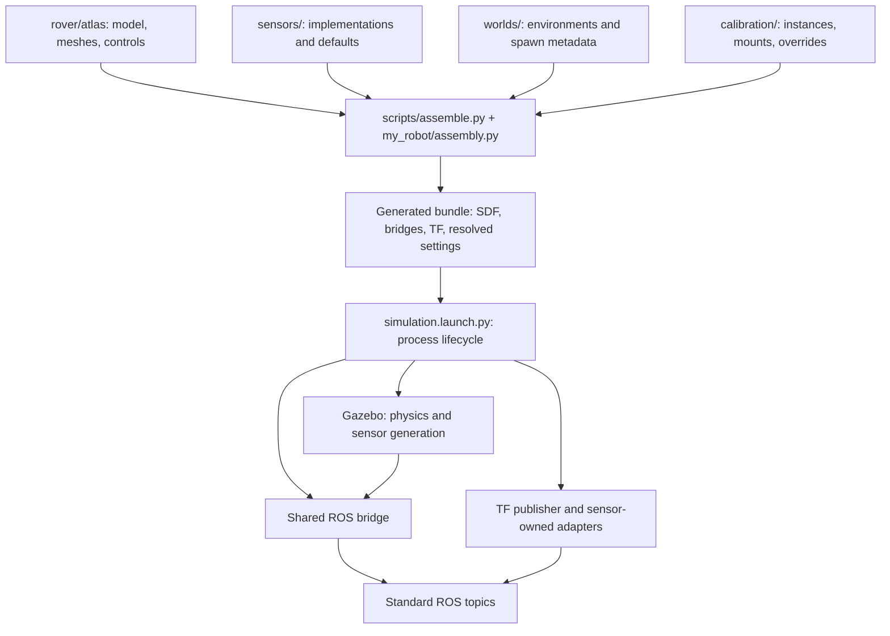

# Reusable components and calibration-driven assembly

The reusable pieces are in `rover/`, `sensors/` and `worlds/`. Files in
`calibration/` describe the sensor instances to attach. Assembly combines them
without editing any component, and runtime processes consume the same resolved
bundle. The existing ROS package name, `my_robot`, is retained for compatibility.

## Codebase and data flow



`run.py` calls the same assembly function as `assemble.py`, then invokes the ROS
launch file. It does not contain a second assembly implementation. The launch
file reads generated artifacts, rather than rereading mutable calibration.

## Where things belong

| Path | Responsibility |
| --- | --- |
| `rover/atlas/model.sdf` | Chassis, wheel geometry/joints, drive controller and simulation truth plugin; no sensor mounts |
| `rover/atlas/meshes/` | Reusable rover assets |
| `rover/atlas/definition.json` | Base frame, exported communication interfaces and control parameter bindings |
| `rover/atlas/control/keyboard_drive.py` | Rover-specific keyboard controls; geometry and command topic come from the resolved rover definition |
| `sensors/<type>/<implementation>/` | SDF fragment, defaults, message declarations, required systems, optional adapters and validation |
| `worlds/*.sdf` | Reusable environments |
| `worlds/*.json` | Default spawn pose, geographic origin and environmental magnetic field |
| `calibration/atlas.json` | ATLAS's five cameras, LiDAR, two IMUs, magnetometer, GNSS and wheel pipelines |
| `calibration/legacy.json` | Original integrated rover's sensor configuration |
| `src/my_robot/my_robot/registry.py` | Load, resolve and validate instances; generate model, bridge and TF descriptions |
| `src/my_robot/my_robot/assembly.py` | Combine components and write the runtime bundle |
| `src/my_robot/my_robot/runtime.py` | Shared ROS launch actions |
| `src/my_robot/my_robot/rover_state.py` | Static sensor TF and optional truth-based rover TF; compatibility helpers |
| `src/my_robot/my_robot/sensor_adapter.py` | Shared runner for sensor-owned ROS processing |
| `src/my_robot/launch/simulation.launch.py` | Gazebo, bridge, TF, adapters, optional controls and RViz |
| `scripts/assemble.py`, `run.py`, `validate.py` | User-facing commands |
| `scripts/setup/` | Dependency installer and verifier |
| `src/my_robot/test/` | Portable and ROS-dependent regression tests |

No synthetic INS or wheel sensor is mandatory. A rover can be assembled with an
empty sensor list. The included four-wheel custom encoder implementation has a
four-joint requirement because of its fixed-size message; that constraint lives
with the encoder component, not in the generic assembler.

## Calibration files

JSON is used for the included files to keep offline assembly dependency-free.
YAML calibration files are also accepted when PyYAML is installed (declared as
an Ubuntu ROS package dependency). The structure is identical.

A camera instance, for example:

```json
{
  "id": "camera_front_left",
  "implementation": "camera/pinhole_rgb",
  "enabled": true,
  "link": "camera_front_left_link",
  "joint": "camera_front_left_mount",
  "sensor_name": "camera_front_left_sensor",
  "parent": "base_link",
  "frame": "camera_front_left_frame",
  "optical_frame": "camera_front_left_optical_frame",
  "calibration": {
    "mount_pose": "0.30 0.12 0.18 0 0 0",
    "sensor_pose": "0.045 0 0 0 0 0",
    "optical_pose": "0 0 0 -1.5707963267948966 0 -1.5707963267948966"
  },
  "settings": {"update_rate": "30"},
  "topics": {
    "sensor": "/rover/camera/front_left/image_raw",
    "data": {
      "ros": "/rover/camera/front_left/image_raw",
      "gz": "/rover/camera/front_left/image_raw"
    },
    "camera_info": {
      "ros": "/rover/camera/front_left/camera_info",
      "gz": "/rover/camera/front_left/camera_info"
    }
  }
}
```

Wrap instances in `{"version": 1, "instances": [...]}`. The file contains sensor
installation information, not rover physics or world configuration.

Each implementation's `definition.json` owns its default settings. Instance
`settings` override those defaults; explicit `--enable` and `--disable` options
override instance enablement for that run. There is no required profile layer.
Camera intrinsics such as image size and horizontal FOV can be overridden using
the declared `camera/...` settings. Current camera calibration is pinhole-based;
arbitrary measured distortion/intrinsic models require corresponding sensor
implementation support, not merely changing CameraInfo values.

Mount and sensor poses are in metres and roll/pitch/yaw radians. The body axes
are forward/left/up; optical axes are right/down/forward. Calibration generates
both Gazebo poses and TF. Measurements retain simulation timestamps.

Disabling a sensor stops its measurement pipeline but retains its physical
housing, mass and collision. Remove its instance from calibration to remove the
physical component. A derived output with a disabled dependency is rejected;
for example disable both `gnss` and `gnss_velocity` together.

## Commands

From the repository root, without ROS or Gazebo:

```bash
python3 scripts/assemble.py --rover atlas --world forest \
  --calibration calibration/atlas.json --output build/atlas-inspect
python3 scripts/validate.py --assembly build/atlas-inspect
```

Use a new or empty output directory. The bundle includes `world.sdf`,
`model.sdf`, `bridge.yaml`, `command_bridge.yaml`, `tf.json`, `sensors.rviz`,
`resolved.json`, copied mesh assets and sensor adapters. Local mesh paths are
resolved into the bundle; external `model://` resources still require their
normal Gazebo resource paths. Bundles contain absolute mesh URIs and should be
regenerated after moving them to another machine or path.

On Ubuntu 24.04 with ROS 2 Jazzy and Gazebo Harmonic:

```bash
source /opt/ros/jazzy/setup.bash
colcon build --packages-up-to my_robot
source install/setup.bash
python3 scripts/run.py --rover atlas --world forest \
  --calibration calibration/atlas.json --control
```

Options include `--disable camera_rear`, `--enable INSTANCE`, `--no-ros`,
`--no-view`, `--headless`, `--render-engine ogre|ogre2` and an explicit quoted
`--spawn-pose`. `--output build/run-name` retains the bundle for inspection.
`--assemble-only --output build/run-name` generates without starting processes.
Headless execution suppresses windows but still needs working GPU rendering.

`--no-ros` disables measurement bridges, adapters, TF and RViz. If controls are
requested, the command bridge is still started. ROS launch is the lifecycle
manager even when measurement communication is disabled. Starting a previously
assembled bundle directly is also supported:

```bash
ros2 launch my_robot simulation.launch.py \
  assembly_dir:="$PWD/build/atlas-inspect" control:=true
```

`rover_sensors.launch.py` remains a ROS-only entry point. Prefer its
`assembly_dir` argument when pairing with a separately launched Gazebo process
so both use exactly the same configuration.

## Adding reusable components

For a sensor implementation, provide `sensor.sdf` and `definition.json` declaring
its family, defaults, outputs and required world systems. Instance names and
poses are injected into a copy of the fragment. Required systems are collected
and deduplicated. Unknown settings and disconnected/cyclic sensor mounts fail
before launch. Current native sensor templates support one sensor per housing;
separate instances can share a parent, as the JT128 IMU does.

For derived sensors, a `plugin.sdf` can declare parameter bindings and lists.
An optional `adapter.py` exposes `create_node(instance, resolved)` for specialized
ROS processing. An optional ROS-independent `validate.py` owns implementation
constraints. The shared adapter runner handles ROS initialization and shutdown.
Native sensors share one `ros_gz_bridge` process; they do not duplicate bridge
startup code. Compiled custom Gazebo plugins would additionally need a normal
build/install package and plugin search-path setup.

For a rover, provide a model, assets and a definition. Model links can serve as
sensor parents. Declare fixed rover transforms in `static_transforms` where
needed. Moving joints require a dynamic rover TF implementation; static sensor
mount transforms alone do not publish moving-joint state. The included ATLAS
truth plugin provides `world -> base_link`; it is a visualization reference,
not a localization estimate.

For a world, provide SDF and optional metadata. Spawn poses can be overridden.
`empty.sdf` is currently a visual-only scene without collision ground; selecting
it requires an explicit spawn pose and does not make it suitable for driving.

## Compatibility and verification

Existing script paths are compatibility wrappers. In particular:

```bash
bash scripts/launch_roam.sh road          # original sensor configuration
bash scripts/launch_roam.sh road --profile atlas
bash scripts/run_rover.sh                # original roam_test selection
```

The old `camera`, `lidar` and `localization` profile names remain command-line
shortcuts. New work should use an explicit calibration file and enable flags.
Standalone basic-rover and old camera/GNSS examples remain separate references.

`models/roam_rover/model.sdf` and the bridge/RViz files in `src/my_robot/config/`
are generated **legacy compatibility snapshots**. Edit the new components and
calibration sources, then refresh snapshots with:

```bash
python3 scripts/generate_registry.py --update-default
python3 scripts/generate_registry.py --check
python3 -m unittest discover -s src/my_robot/test -p test_registry.py -v
```

All top-level component assets are installed into the ROS package share with
the same directory structure. The portable tests exercise this installed layout,
a second rover, duplicate sensor instances, empty sensor lists, settings
isolation, dependency validation, all supported worlds and legacy model/bridge
regression fixtures. ROS-dependent tests additionally require a built workspace:

```bash
colcon test --packages-select my_robot
colcon test-result --verbose
python3 scripts/validate.py --assembly build/atlas-inspect --live --duration 20
bash scripts/record_sensors.sh atlas build/atlas-bag
```

The bag helper's `atlas` shortcut uses the checked-in ATLAS calibration. For a
custom assembly, get the exact topic list with
`python3 scripts/validate_sensors.py --assembly PATH --print-topics` and pass those
topics to `ros2 bag record --use-sim-time`. Live validation checks topic types,
headers, basic data, TF and simulation-time rates. It does not prove physical
accuracy or full synchronization behavior.

## ATLAS interface and simulation fidelity

The ATLAS calibration follows the supplied proposed v0.1 topic specification:
LiDAR points and integrated IMU; five image/CameraInfo pairs; BNO085 IMU and
magnetometer; GNSS fix and velocity; wheel JointState and wheel odometry.
The exact resolved topic/frame/rate contract is written to `resolved.json`.
Lenses and the GNSS antenna are not independent message sources.

The Hesai folder is explicitly a generic 360x128 GPU-grid approximation, not a
JT128 firing-pattern or per-point timing model. The cameras use provisional
640x480, 1.047 rad FOV and a 0.24 m front stereo baseline. IMU and magnetic-field
behavior is generic Gazebo behavior. GNSS velocity is interval-average truth
antenna velocity plus noise, not ZED-F9P Doppler/RTK processing. The encoder
adapter does not model ticks or missed pulses. These are interface-compatible
integration approximations, not measured hardware calibration or complete
hardware-fidelity guarantees.

Portable checks can run on Windows. Live Gazebo, ROS message tests, rendering,
and sample bag validation must still be completed on the Ubuntu runtime before
claiming end-to-end behavior preservation.
